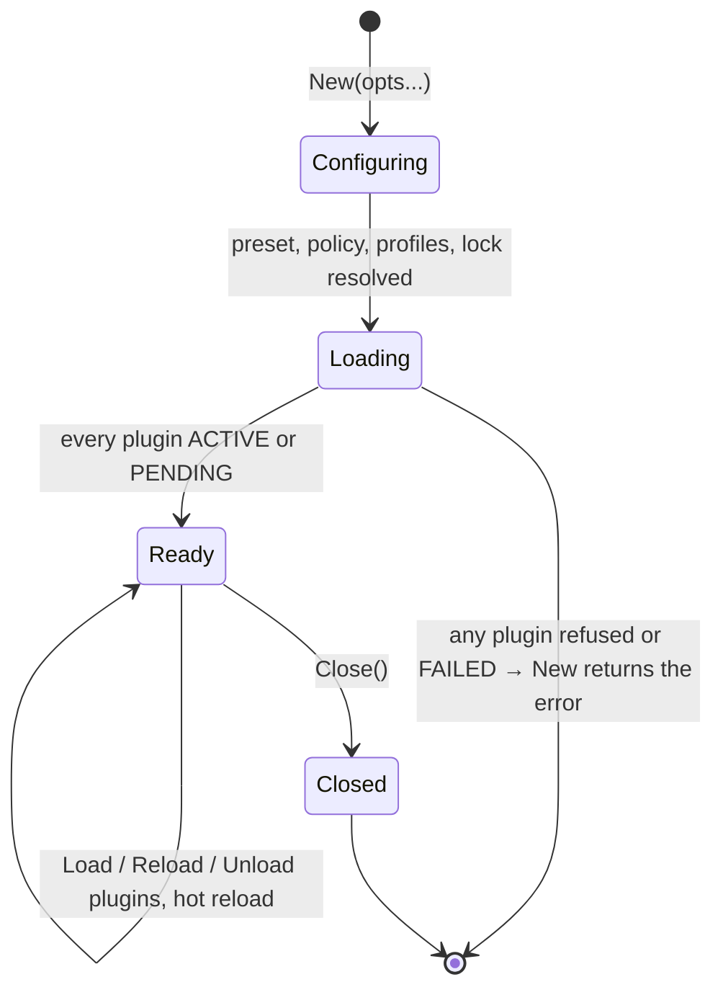
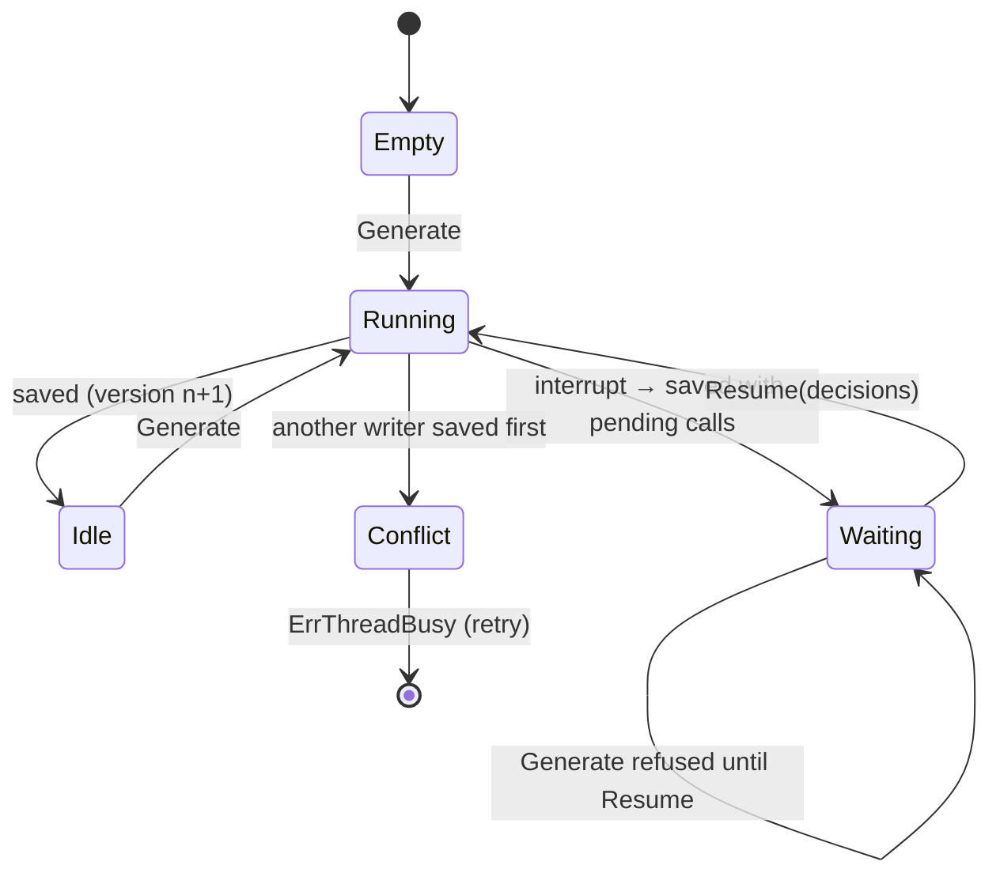
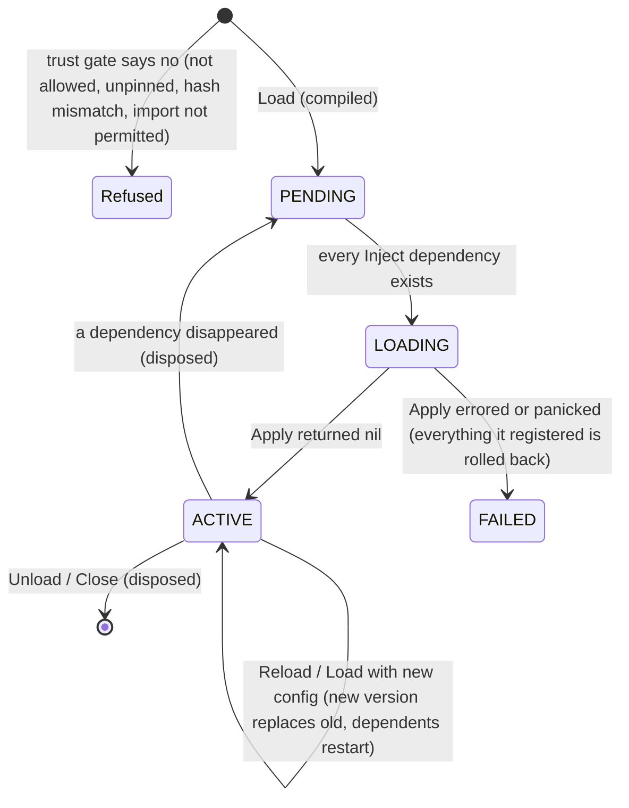

# eipagent

**eipagent is an agent SDK for Go where everything is a plugin. It is built for companies and aims to be simple to use and secure by default.**

- **Everything is a plugin.** The core engine only loads plugins and routes calls between them. The agent loop, every LLM provider, tools, memory, middleware, sandboxes, persistence, tracing, audit and the policy rules are all plugins, and you can swap any of them. The model is [DeepSeek Harness](https://github.com/deepseek-ai/deepseek-harness) and its Cordis plugin framework.
- **Easy to use.** The API looks like the [AI SDK](https://ai-sdk.dev): `Generate`, `Stream`, `GenerateObject[T]` and typed `Tool(...)`.
- **Feature rich.** It covers what [LangChain](https://docs.langchain.com/oss/python/langchain/overview) offers: many providers, a middleware pack, durable memory, human-in-the-loop, MCP, multi-agent and skills.
- **Secure by default.**
  - Plugins are pinned by sha256 and limited to the capabilities they declare.
  - A locked policy layer always runs first.
  - The audit log is tamper-evident.
  - Each plugin gets only the secrets granted to it.
  - Sandboxes are pluggable, and the agent can run inside one.

**Demo:** [`examples/fullstack`](examples/fullstack) is a support desk with a Go backend and web UI: streaming, refunds that wait for a supervisor, redaction and an audit trail. Run it with `go run ./examples/fullstack`, or try it live at https://eipagent-docs.vercel.app/demo/ (the backend runs on a free instance, so the first visit can take a minute to wake it).

**Docs:** https://eipagent-docs.vercel.app has the full guide, with examples, lifecycles and reference. The source is `docs/site.html`; run `docs/build.sh` to regenerate `docs/public/index.html`, then deploy with `vercel deploy --prod` from `docs/public`.

Requires **Go 1.27**. Install a tagged release:

```bash
go get github.com/ganeshdipdumbare/eipagent@v0.4.0
```

The repository is private, so Go needs to know that and needs git access: run `go env -w GOPRIVATE=github.com/ganeshdipdumbare/*` once, and `gh auth setup-git` (or an SSH key) so `git` can fetch it. Releases and breaking changes are listed in [CHANGELOG.md](CHANGELOG.md); see [Versioning](#versioning).

```bash
go test ./...                    # offline: the mock model needs no keys
go run ./examples/readme         # runs every example in this README
```

## Contents

1. [Examples](#examples)
2. [How it works: lifecycles](#how-it-works-lifecycles)
3. [Plugins](#plugins)
4. [Sandboxes](#sandboxes)
5. [Security](#security)
6. [Scaling and persistence](#scaling-and-persistence)
7. [CLI](#cli)
8. [Status](#status)

---

## Examples

Every snippet below comes from [`examples/readme/main.go`](examples/readme/main.go). `go test` builds and runs that file with the offline mock model, so the snippets always match the API. To use a real model, replace `"mock:demo"` with a model string such as `anthropic:claude-sonnet-5-5`, `openai:gpt-4.1`, `gemini:gemini-2.5-pro`, `deepseek:deepseek-chat` or `ollama:llama3`. Set the provider's API key (`ANTHROPIC_API_KEY`, `OPENAI_API_KEY` and so on) in the environment.

**Run everything locally with [Ollama](https://ollama.com).** No API keys are needed and nothing leaves your machine:

```bash
ollama pull lfm3
go run ./examples/ollama -demo text      # also: stream, tools, plugins, object, thread, approve, shell, vision
```

The model string is just `ollama:<model>` (for example `ollama:qwen3.5:4b`). Set `OLLAMA_HOST` to use an Ollama running on another machine. See [`examples/ollama`](examples/ollama/main.go).

**Production features, each as a runnable program** (offline, no keys needed):

| Example | Shows |
|---|---|
| [`examples/secrets`](examples/secrets/main.go) | `secrets_vault` against an in-process Vault: per-plugin grants, a plugin that can't ask as another, key rotation without a restart, a leaked key redacted from logs and audit, `secret.access` records |
| [`examples/microsandbox`](examples/microsandbox/main.go) | the agent in a [microsandbox](https://microsandbox.dev) microVM with no network (needs `msb`): no secret env vars in the VM, a plugin that holds only a placeholder, the host swapping in the real token for an allowed host, the echoed token redacted, and the placeholder refused for any other host |
| [`examples/observability`](examples/observability/main.go) | `audit_http` to an in-process SIEM that checks HMAC signatures and the hash chain; `trace_otlp` to an in-process OpenTelemetry collector, printing the span tree and the shared fields (`run`, `thread`, `user`, `plugin`, `provider`) |
| [`examples/plugin-validate`](examples/plugin-validate/main.go) | the linter's report on a plugin with mistakes, then a signed package, and what verification refuses: a tampered file, a manifest that grants itself `exec`, an unknown signer, an unsigned package, a wrong pin |
| [`examples/plugin-store`](examples/plugin-store/main.go) | one plugin through install, approval, enable, update, a failed update that keeps the old version, rollback and quarantine, in a running agent |
| [`examples/plugins`](examples/plugins) | a ready-made plugin for every `eip plugin init` choice: tool, hook, model provider, memory, sandbox, trigger, MCP adapter |

### Generate with a typed tool

```go
type WeatherIn struct {
	City string `json:"city" desc:"city name"`
}

weather := eipagent.Tool("weather", "Current weather for a city",
	func(ctx context.Context, in WeatherIn) (string, error) {
		return "18°C and light rain in " + in.City, nil
	})

agent, err := eipagent.New(
	eipagent.WithModel("anthropic:claude-sonnet-5-5"),
	eipagent.WithInstructions("You are a concise travel assistant."),
	eipagent.WithTools(weather),
)
defer agent.Close()

res, err := agent.Generate(ctx, "What's the weather in Lisbon?")
res.Text                 // final answer
res.Steps                // every model call with its tool results
res.ToolCalls()          // all tool calls in the run
res.Usage.TotalTokens    // token accounting
res.FinishReason         // stop | max_steps | interrupted | tool:<name>
```

The JSON Schema for the tool's arguments is derived from `WeatherIn`. The `json`, `desc` and `enum:"a,b"` tags are honoured; a field marked `omitempty` or declared as a pointer is optional. A tool can return any type: strings go to the model as they are, and everything else is sent as JSON.

### Streaming

```go
s := agent.Stream(ctx, "A haiku about Lisbon")
for delta := range s.Text() {
	fmt.Print(delta)
}
res, err := s.Result()

// Or every event: text, reasoning, tool_call, tool_result, step_start,
// step_end, interrupt, finish, error.
for e := range agent.Stream(ctx, "...").Events() {
	if e.Type == "tool_call" {
		fmt.Println("calling", e.ToolCall.Name)
	}
}
```

Breaking out of a loop early is safe: the run still completes, and `Result()` returns it.

### Structured output

```go
type Trip struct {
	City    string   `json:"city"`
	Packing []string `json:"packing" desc:"things to pack"`
	Budget  int      `json:"budget_eur,omitempty"`
}

trip, err := eipagent.GenerateObject[Trip](ctx, agent, "Plan what to pack for Lisbon.")
```

How the schema reaches the model depends on the provider:

- OpenAI and Gemini use their native JSON-schema mode.
- Anthropic gets the schema as a forced tool.
- DeepSeek and Groq use JSON mode, with the schema in the prompt.

If the reply doesn't parse, eipagent asks the model once to repair it and then returns `ErrNoObject`.

### Threads (durable conversations)

```go
agent, err := eipagent.New(
	eipagent.WithModel("openai:gpt-4.1"),
	eipagent.WithPlugin("threads_file", map[string]any{"dir": ".eipagent/threads"}), // or threads_sql
)
th := agent.Thread("customer-42")
th.Generate(ctx, "My name is Ada.")
th.Generate(ctx, "What's my name?") // sees the earlier turn
msgs, _ := th.Messages(ctx)
```

Without `WithPersistence`, threads are kept in memory (`threads_inmem`).

### Human in the loop

```go
agent, _ := eipagent.New(
	eipagent.WithModel("openai:gpt-4.1"),
	eipagent.WithTools(refund),
	eipagent.WithPlugin("hook_approval", map[string]any{"interrupt_on": map[string]any{"refund": true}}),
)
th := agent.Thread("ticket-981")
res, _ := th.Generate(ctx, "Refund order A-17")
for res.Interrupted() { // paused before the tool ran; the pause is saved
	in := res.Interrupts[0]
	fmt.Println("approve?", in.Message, in.ToolCall.Args)
	res, _ = th.Resume(ctx, eipagent.Approve(in.ID)) // or Reject(id, why) / Edit(id, args) / Respond(id, text)
}
```

The pause is saved with the thread. With `threads_sql`, a different process or pod can resume it, possibly hours later. Two other ways to answer interrupts:

- **Without a thread:** call `agent.Resume(ctx, res, decisions)`. The state travels in `res`.
- **In-process, synchronously:** pass `eipagent.WithApprover(func(ctx, in) (*Decision, error))`, for example to prompt in a CLI.

To pause on everything risky instead of naming tools, use `{"non_readonly": true}` or `{"risk": ["high"]}`. You can also put `hook_review` in front: a reviewer model then approves, denies or escalates each call to a human.

### Hooks from the standard plugins

```go
agent, _ := eipagent.New(
	eipagent.WithModel("anthropic:claude-sonnet-5-5"),
	eipagent.WithPlugin("hook_retry", map[string]any{"max_retries": 3}),                         // 429/5xx with backoff
	eipagent.WithPlugin("hook_fallback", map[string]any{"models": []any{"openai:gpt-4.1"}}),     // next model on failure
	eipagent.WithPlugin("hook_limits", map[string]any{"model_calls_run": 20, "tool_calls_run": 50}),
	eipagent.WithPlugin("hook_pii", map[string]any{"types": []any{"email", "credit_card"}}),     // redact, mask, hash or block
	eipagent.WithPlugin("hook_summarize", map[string]any{"trigger_messages": 40, "keep_messages": 10}),
)
```

### Your own hooks

A compiled plugin is ordinary Go code. An interpreted plugin is the same code in a `.go` file loaded at runtime (see [Plugins](#plugins)).

```go
timing := eipagent.Plugin{Name: "timing", Apply: func(p *eipagent.PluginAPI) error {
	p.WrapModel(func(c context.Context, req *eipagent.ModelRequest, next eipagent.ModelHandler) (*eipagent.ModelResponse, error) {
		resp, err := next(c, req) // the model call, plus any inner hooks
		if err == nil {
			p.Logf("%s step %d used %d tokens", req.Model, req.Step, resp.Usage.TotalTokens)
		}
		return resp, err
	})
	p.WrapTool(func(c context.Context, req *eipagent.ToolRequest, next eipagent.ToolHandler) (*eipagent.ToolResult, error) {
		if req.Call.Name == "drop_database" {
			return &eipagent.ToolResult{Content: "not allowed", IsError: true}, nil
		}
		return next(c, req)
	})
	return nil
}}
agent, _ := eipagent.New(eipagent.WithModel("openai:gpt-4.1"), eipagent.WithCompiledPlugin(timing))
```

### Add, update and remove plugins at runtime

```go
eng := agent.Engine()
eng.Load(eipagent.PluginSpec{Use: "tool_memory"}) // needs "memory", so it waits: PENDING
eng.Load(eipagent.PluginSpec{Use: "memory_inmem"})  // the store arrives, tool_memory becomes ACTIVE
eng.Load(eipagent.PluginSpec{Use: "hook_pii", Config: map[string]any{"strategy": "hash"}}) // load again = update config
eng.Reload("hook_pii")                               // recompile from source
eng.Unload("memory_inmem")                          // tool_memory goes back to PENDING and its tools disappear
for _, s := range agent.Status() { fmt.Println(s.String()) }
```

A run that is already in progress keeps the plugins it started with. If an update fails, the old version keeps running. See [Plugin lifecycle](#plugin-lifecycle).

To see it live with a local model, run `go run ./examples/ollama -demo plugins`. The demo starts with no tools, loads `tool_time`, writes a brand-new plugin file and loads it, edits that file's code and reloads it, shows a broken edit being refused while the old version keeps working, and then unloads everything. The model is asked a question after each step.

### Subagents and handoffs

```go
agent, _ := eipagent.New(
	eipagent.WithModel("openai:gpt-4.1"),
	eipagent.WithPlugins("tool_time"),
	eipagent.WithPlugin("tool_subagents", map[string]any{"agents": []any{
		map[string]any{"name": "researcher", "description": "Finds facts",
			"instructions": "Research carefully.", "tools": []any{"current_time"}},       // called as a tool
		map[string]any{"name": "billing", "description": "Invoices and refunds",
			"instructions": "You are billing support.", "mode": "handoff"},             // takes over the thread
	}}),
)

// A whole agent, with its own plugins, model and policy, can also be a tool:
eipagent.WithTools(expertAgent.AsTool("legal_expert", "Answers legal questions"))
```

### Shell and file tools in a sandbox

```go
agent, _ := eipagent.New(
	eipagent.WithModel("openai:gpt-4.1"),
	eipagent.WithPlugins("sandbox_docker"),                                     // or sandbox_local, or your own
	eipagent.WithPlugin("workspace_sandbox", map[string]any{"provider": "docker"}),  // one box per thread, no network
	eipagent.WithPlugins("tool_shell", "tool_fs"),
)
res, _ := agent.Generate(ctx, "Write notes.md and count its lines")
for _, ch := range res.Changes { // review what the agent changed
	fmt.Print(ch.Diff())
}
```

### MCP servers, skills, the web

```go
eipagent.WithPlugin("tool_mcp", map[string]any{"servers": []any{
	map[string]any{"name": "github", "command": "github-mcp-server", "args": []any{"stdio"},
		"env": map[string]any{"GITHUB_TOKEN": "secret://GITHUB_TOKEN"}},
	map[string]any{"name": "docs", "url": "https://mcp.internal.example.com/mcp"},
}}) // tools appear as github__create_issue, docs__search, ...
eipagent.WithPlugin("tool_skills", map[string]any{"dirs": []any{"./skills"}})       // folders with SKILL.md
eipagent.WithPlugin("tool_fetch", map[string]any{"allow_hosts": []any{"*.wikipedia.org"}})
```

### Scheduled jobs and webhooks

```go
eipagent.WithPlugin("trigger_schedule", map[string]any{"jobs": []any{
	map[string]any{"name": "weekly-report", "schedule": "weekly fri 17:00", "prompt": "Summarize this week's tickets", "user": "ops"},
}}) // the model also gets schedule_create / schedule_list / schedule_cancel
eipagent.WithPlugin("trigger_webhook", map[string]any{"routes": []any{
	map[string]any{"path": "/github", "secret": "secret://GH_WEBHOOK_TOKEN", "thread": "gh-{repository.full_name}"},
}}) // requests must carry an HMAC-SHA256 signature
```

### Profiles: configure everything in a file

```json
{
  "model": "anthropic:claude-sonnet-5-5",
  "instructions": "You are the internal engineering assistant.",
  "max_steps": 30,
  "plugins": [
    { "use": "hook_retry" },
    { "use": "hook_approval", "config": { "non_readonly": true } },
    { "use": "model_openai", "as": "llm_local", "config": { "name": "local", "base_url": "http://vllm:8000/v1", "api_key": "" } },
    { "use": "threads_sql" }
  ]
}
```

Load it with `eipagent.New(eipagent.WithProfile("eip.json"))`. Layers apply in order, and later ones win:

1. Profiles, in the order given.
2. Options passed in code.
3. The admin policy, which nothing can override.

[`examples/corporate/`](examples/corporate) has a complete corporate profile and policy.

---

## How it works: lifecycles

### Agent lifecycle



**`New`:**

1. **Resolve the configuration.** The preset (`secure` by default, or `dev`) or an explicit admin policy, the profiles, the code options and `eip.lock` combine into one plugin list.
2. **Load plugins in a fixed order:**
   1. Plugins the policy requires, such as audit, policy and secrets. They load first so they see everything after them.
   2. Built-ins: `agent_service`, `loop`, `secrets_env` and `threads_inmem`.
   3. Your plugins.
   4. The provider implied by the model prefix, if no profile row provides it.

   A plugin of the same family replaces a default. For example, `threads_sql` replaces `threads_inmem`.
3. **Pass each plugin through the trust gate**, then start it (see the plugin lifecycle below).
4. **Fail fast.** If any plugin is refused or fails, everything already loaded is disposed and `New` returns the error. You never get a half-configured agent.
5. **Start the file watcher** if the policy allows hot reload.

**Ready:** an agent is safe for concurrent use. Each run takes a snapshot of the current plugins and keeps it. You can load, reload and unload plugins while runs are in progress.

**`Close`:** disposes every plugin in reverse load order, running each one's cleanups. The effects:

- Sandboxes are destroyed.
- Jobs and webhook runs are cancelled and awaited.
- MCP server processes are stopped.
- Database pools are closed.
- `Close` is idempotent: calling it twice is safe.

### Run lifecycle (one `Generate` / `Stream` / `Resume`)


Step by step:

1. **Start.**
   - The facade builds the run state: history, the new user message, model, instructions and the user's identity.
   - It takes a **snapshot** of the plugins, so a change made during the run won't show up until the next one.
   - It hands the run to the `loop` service, which is itself a plugin.
   - **`agent/start`** hooks run. An error from one refuses the run.
2. **Resume (only when resuming).** Pending tool calls run first, using the decisions you supplied:
   - `approve` runs the call.
   - `edit` runs it with your arguments.
   - `reject` and `respond` send your text to the model instead of running the tool.
3. **Each step**, up to `max_steps` (default 20):
   1. **Build the request.** The system prompt is the instructions plus the skill prompts. The tools are the registered tools plus any per-run tools.
   2. **`step/prepare`** hooks may rewrite the model, messages, tools or tool choice. Summarization and handoffs work this way.
   3. **`model/wrap`** middleware runs as an onion, highest priority outermost, around the provider call. Retry, fallback, PII redaction, limits, audit and tracing live here. Streaming chunks become `text` and `reasoning` events.
   4. **`model/after`** hooks inspect the reply. They can set `Jump`: `"end"` stops the run, `"model"` asks the model again.
   5. **No tool calls** means the run finishes with `stop`.
   6. **Tool calls:** each one runs through **`tool/wrap`**, as an onion with the highest priority outermost. Then the tool runs. Tools run one at a time, or in parallel with `parallel_tools`.
      - A plain error goes back to the model as the tool result, so it can recover.
      - `sdk.Fatal(err)` aborts the run.
      - A returned **interrupt** pauses the run. If an `approver` service is loaded, it can decide on the spot. Otherwise the run finishes `interrupted`, and the pending calls are kept in the run state, or in the thread when there is one.
   7. If a tool listed in `StopOnTool` was called, the run finishes with `tool:<name>`.
4. **Stop.** Reaching the step limit finishes the run with `max_steps`.
5. **End.** **`agent/end`** hooks always run exactly once, even when the run fails (`FinishReason: "error"`), so plugins can always clean up. Observers then get `finish`, or `error` when the run failed.

Default priorities (higher means outer). Set `priority` on a profile row to override a value; the reserved band is only for locked plugins.

| Priority | Model middleware (`model/wrap`) | Tool middleware (`tool/wrap`) |
|---|---|---|
| reserved band | `audit_file`, `policy` (when locked) | `audit_file`, `policy` (when locked) |
| 30 | `hook_pii` | `hook_pii` |
| 20 | `hook_fallback` | |
| 10 | `hook_retry` | `hook_retry` (`tool_retries`) |
| 0 | `hook_limits`, `hook_log`, `trace_file`, your plugins (in load order) | `hook_review`, `hook_limits`, `hook_log`, `trace_file`, your plugins |
| −10 | | `hook_approval` (innermost, so reviewers and policy decide first) |

Events in order: `step_start`, then the `text`/`reasoning` deltas, `step_end`, `tool_call`, and `tool_result` or `interrupt`, repeated for each step; then `finish` or `error`. `OnEvent` and `Stream.Events()` see the same events.

### Thread lifecycle



Each turn goes through four steps:

1. **Load** the state (messages, pending interrupts, plugin values such as the active handoff agent or the sandbox id) from the `threads` service.
2. **Run** the turn.
3. **Save** with optimistic versioning. If another process saved first, you get `ErrThreadBusy` and nothing is lost.
4. **Wait on pauses.** A thread with pending interrupts accepts only `Resume`.

Any process that shares the thread storage can continue any thread.

### Plugin lifecycle



- **Trust gate.** Before any plugin code runs, the core:
  - checks the policy allow/deny lists;
  - checks the sha256 pin (file plugins under the secure preset);
  - parses the source for `Inject`, `Permissions` and imports;
  - intersects the declared permissions with the policy's grants;
  - refuses any import those permissions don't cover;
  - then interprets the plugin with a symbol table restricted to exactly those packages.
- **Dispose.** Everything a plugin registered through its context is undone in reverse order: tools, services, hooks, skills and `Effect` cleanups.
- **Safe updates.** If a reload fails to compile or start, the old version keeps running.
- **Locked plugins** (from the policy) can't be unloaded or replaced at runtime, and only they may use the reserved, outermost priority band.

### Sandbox lifecycle (`workspace_sandbox`)

1. **Created lazily**, the first time a shell or file tool runs in a thread. Each thread gets its own box.
2. **Reused** for every later turn of that thread.
3. **Remembered.** The box id is saved in the thread at the end of each run.
4. **Re-attached** when the thread resumes in a new process.
5. **Destroyed** after `idle_ttl_seconds`, or when the plugin unloads or the agent closes.

With `tool_sandbox`, the model creates and destroys boxes itself, up to `max_boxes` per thread.

### Remote agent lifecycle (`WithRunIn`)

1. `New` builds a small **host** agent. It holds the model provider and its keys, the sandbox provider, and your Go tools.
2. The host creates a box. It uploads the `eip` binary, the profile, the admin policy, `eip.lock` and the plugin sources.
3. The host starts `eip serve --stdio` in the box.
4. The box builds its agent and replies `ready`, or reports the startup error.
5. Runs and threads are proxied over JSON-RPC. Model calls come back to the host, through the host's middleware and policy, so keys never enter the box. Your Go tools are bridged back too.
6. `Close` stops the process, destroys the box and closes the host agent.

---

## Plugins

Everything the agent does comes from a plugin, but **most apps never type a plugin name**. Common setups are options, and plumbing (the loop, a workspace for shell tools, the database connection) loads itself and shows as `auto` in `agent.Status()`:

```go
agent, _ := eipagent.New(
	eipagent.WithModel("anthropic:claude-sonnet-5-5"),            // model_anthropic
	eipagent.WithApprovals("issue_refund"),                       // hook_approval
	eipagent.WithPersistence("postgres", "secret://DATABASE_URL"), // threads_sql + memory_sql + db_sql
	eipagent.WithSandbox("docker"),                               // sandbox_docker + workspace_sandbox
	eipagent.WithAudit("/var/log/eipagent/audit.jsonl"),          // audit_file
	eipagent.WithTracing("http://otel-collector:4318"),           // trace_otlp
	eipagent.WithMCP("github", "npx", "-y", "@modelcontextprotocol/server-github"), // tool_mcp
)
```

**Writing one takes one function.** A plugin is a Go file with `Apply`, interpreted at runtime by [Yaegi](https://github.com/traefik/yaegi) (or a compiled `eipagent.Plugin` with the same `Apply`). Inside it, call what you need:

| You want… | Call |
|---|---|
| the model to be able to do something | `p.AddTool` |
| something to happen around every model or tool call | `p.WrapModel`, `p.WrapTool`, `p.OnRunStart` … |
| other plugins to use something you provide | `p.Provide("model/acme", …)` |
| background work, stopped on unload | `p.Effect`, `p.OnUnload` |

```go
//go:build ignore

package plugin

import (
	"context"

	"eipagent/sdk"
)

var Requires = []string{"?secrets"} // services needed first ("?x" optional, "model/*" any one)
var Permissions = []string{"net"}   // net, exec, fs:read, fs:write, env, env:secrets, db

func Apply(p *sdk.Plugin) error {
	p.AddTool(sdk.Tool{
		Name: "greet", Description: "Greet someone",
		Schema: sdk.Object(map[string]any{"name": sdk.Str("who")}, "name"),
		Run: func(c context.Context, args map[string]any) (string, error) {
			return "Hello, " + sdk.ArgString(args, "name"), nil
		},
	})
	return nil
}
```

You never have to decide what kind of plugin you're writing. `eip plugin init NAME` asks what it should do and writes a working one, and `eip plugin validate` says what yours does (`greet: adds 1 tool (greet) · permissions net`).

The [docs' Plugins section](https://eipagent-docs.vercel.app/#plugins) has, for every kind: what it is, when to use it and when not, every built-in with its config, how to write your own (a full working file and a test), and the gotchas. It starts with [what to use when](https://eipagent-docs.vercel.app/#plugins-choose), a goal-first table. [PLUGINS.md](PLUGINS.md) is the short version.

### Standard plugins (embedded in the binary)

Named by what they do. The prefix is a convention for the plugins we ship, not a rule for yours.

| Kind | Plugins |
|---|---|
| [Tools](https://eipagent-docs.vercel.app/#kind-tools): the model can call them | `tool_shell`, `tool_fs`, `tool_fetch`, `tool_time`, `tool_memory`, `tool_mcp`, `tool_subagents`, `tool_skills`, `tool_sandbox` |
| [Hooks](https://eipagent-docs.vercel.app/#kind-hooks): run around calls | `hook_retry`, `hook_fallback`, `hook_limits`, `hook_summarize`, `hook_approval`, `hook_review`, `hook_pii`, `hook_tool_errors`, `hook_log`, `hook_guard`, `hook_stats` |
| [Model providers](https://eipagent-docs.vercel.app/#kind-models) | `model_openai` (OpenAI, DeepSeek, Ollama, vLLM, OpenRouter, Groq), `model_anthropic`, `model_gemini`, `model_mock` |
| [Threads and memory](https://eipagent-docs.vercel.app/#kind-threads-memory) | `threads_inmem` / `_file` / `_sql`, `memory_inmem` / `_file` / `_sql`, `db_sql` |
| [Sandboxes and workspaces](https://eipagent-docs.vercel.app/#kind-sandboxes) | `sandbox_local`, `sandbox_docker`, `sandbox_microsandbox`, `workspace_local`, `workspace_sandbox` |
| [Triggers](https://eipagent-docs.vercel.app/#kind-triggers) | `trigger_schedule`, `trigger_webhook` |
| [Telemetry and audit](https://eipagent-docs.vercel.app/#kind-telemetry) | `trace_file`, `trace_otlp`, `audit_file`, `audit_http` |
| [Secrets](https://eipagent-docs.vercel.app/#kind-secrets) | `secrets_env`, `secrets_vault` |
| [Policy and the loop](https://eipagent-docs.vercel.app/#kind-policy) | `policy`, `loop` |

Renamed in v0.4: `llm_*` → `model_*`, `mw_*` → `hook_*` (`mw_hitl` → `hook_approval`), `checkpoint_*` → `threads_*`, `store_*` → `memory_*`, `exec_*` → `workspace_*`, `jobs` → `trigger_schedule`, `audit_jsonl` → `audit_file`, `agents` → `tool_subagents`, `memory_store` → `tool_memory`. The old names keep working until v1.0 (see [CHANGELOG.md](CHANGELOG.md)).

### Ship plugins: scaffold, validate, sign, install

```bash
eip plugin init weather                          # asks what it should do: tool, hook, model, memory, sandbox, trigger, mcp
eip plugin validate weather                      # lint, and a one-line summary of what it does
eip plugin fix weather                           # rewrite names renamed in v0.4
eip plugin build -key signing.key weather        # signed, hashed weather-0.1.0.eip
eip plugin install weather-0.1.0.eip             # verified and held (VALIDATED)
eip plugin approve weather 0.1.0                 # APPROVED
eip plugin enable weather                        # ACTIVE; update / rollback / quarantine / uninstall too
```

In Go, `eipagent.WithPluginStore(st)` attaches a `pluginpkg.Store` to a running agent, and enable, update and rollback swap plugins live. A version that fails to start never replaces the running one. Examples for every template are in [`examples/plugins`](examples/plugins), and [`examples/plugin-store`](examples/plugin-store) walks the whole lifecycle.

A model string `provider:model` loads the matching provider automatically. The prefixes are `openai`, `deepseek`, `anthropic`, `gemini`/`google`, `ollama`, `openrouter`, `groq` and `mock`.

## Sandboxes

There are two directions:

- **The agent uses sandboxes.** Load `workspace_sandbox`, and the shell and file tools run in a per-thread box. Load `tool_sandbox`, and the model can start boxes on demand.
- **The agent runs inside a sandbox:**

  ```go
  eipagent.New(
  	eipagent.WithModel("openai:gpt-4.1"),
  	eipagent.WithPlugins("tool_shell", "tool_fs"),
  	eipagent.WithRunIn(eipagent.RunIn{Provider: "docker", Binary: "./eip-linux"}), // GOOS=linux go build -o eip-linux ./cmd/eip
  )
  ```

Providers: `sandbox_local` (no isolation, for development), `sandbox_docker` (Docker or Podman, with no network by default) and `sandbox_microsandbox` ([microsandbox](https://microsandbox.dev) microVMs, with no network by default). Any other backend, such as Firecracker, E2B or Kubernetes, only needs to provide `sdk.SandboxProvider`. See [`examples/custom-sandbox`](examples/custom-sandbox).

## Security

`eipagent.New()` starts in the **secure** preset:

- File plugins must be pinned in `eip.lock` (`eip plugin pin`).
- Hot reload is off.
- Plugins get only the permissions they declare, narrowed further by the admin policy.

An admin `policy.json` adds:

- locked `policy` and `audit_file` plugins;
- the approval mode: read-only, workspace-write or full-access;
- tool and model allowlists, token budgets and per-role rules;
- per-plugin secret grants.

The threat model, and what isn't guaranteed, is in [SECURITY.md](SECURITY.md). Use `WithPreset("dev")` for local plugin development.

## Scaling and persistence

The core engine is stateless and needs no database. All state lives behind plugin services: `threads`, `memory`, `audit` and `jobs`. For multiple replicas:

```go
import _ "github.com/ganeshdipdumbare/eipagent/drivers/postgres"

eipagent.WithPersistence("postgres", "secret://EIP_DATABASE_URL") // db_sql + threads_sql + memory_sql
```

With this setup:

- Any replica can serve any thread.
- A human approval paused on one pod can be resumed on another.
- Concurrent writes return `ErrThreadBusy` instead of overwriting each other.

## CLI

```bash
go run ./cmd/eip -model openai:gpt-4.1 -use tool_time
```

Opens the REPL. It has `/plugins`, `/load`, `/unload` and `/reload`, and asks inline when a tool needs approval.

```bash
go run ./cmd/eip run -model mock:x "hello"
```

Runs one prompt headless. Add `-json` or `-thread ID`.

```bash
go run ./cmd/eip plugin pin -plugins ./plugins -lock eip.lock
```

Pins plugin sources for the secure preset. `eip plugin help` lists the authoring commands (`init`, `validate`, `build`, `inspect`, `keygen`) and the store lifecycle (`install`, `approve`, `enable`, `disable`, `update`, `rollback`, `quarantine`, `uninstall`, `list`). Add `-store DIR` to `run`, `repl` or `serve` to load a store's enabled plugins.

```bash
go run ./cmd/eip trace view .eipagent/trace.jsonl > trace.html
```

Renders a trace as an HTML timeline.

```bash
go run ./cmd/eip config dump -profile eip.json
```

Shows the policy and every plugin's state.

`go run ./cmd/eip serve --stdio` is what runs inside sandboxes. You don't start it yourself.

## Versioning

eipagent follows [semantic versioning](https://semver.org) with git tags (`v0.4.0`). The Go module is `github.com/ganeshdipdumbare/eipagent`. `sdk.Version` holds the version the code reports, and plugin manifests state which versions they work with (`"eipagent": ">=0.4.0, <1.0.0"`).

While the major version is 0:

- **Patch releases** (`v0.4.x`) fix bugs and security issues without breaking the public API.
- **Minor releases** (`v0.x.0`) may break it. Every break is listed under "Breaking changes" in [CHANGELOG.md](CHANGELOG.md), with what to change.

The public API is:

- the `eipagent` package (`New`, options, `Generate` / `Stream` / `Thread` ...);
- `sdk`, which plugins are written against;
- `pluginpkg`, `audit` and `engine`'s exported functions;
- the `plugin.json` manifest schema, the `.eip` package format and the audit record format;
- the `eip` CLI commands and flags;
- the names and config keys of the standard plugins.

Interpreted plugins import the SDK as `"eipagent/sdk"`. That import is an alias the engine keeps stable across releases and module moves, so plugin files never need changing for it.

To depend on a version, `go get github.com/ganeshdipdumbare/eipagent@vX.Y.Z`. To try unreleased work, `go get github.com/ganeshdipdumbare/eipagent@main`, or a local checkout with `replace github.com/ganeshdipdumbare/eipagent => ../eipagent`.

## Status

**Done, with tests:**

- the core engine and trust gate
- the facade
- four providers
- streaming and structured output
- the middleware pack
- threads (in-memory, file and Postgres)
- human-in-the-loop, including across processes
- MCP (stdio and HTTP)
- subagents and handoffs
- skills
- both sandbox directions (local and Docker)
- policy, audit and secrets
- tracing and the viewer
- jobs and webhooks
- the CLI
- the lifecycle guarantees described above
- plugin manifests, linting, signed packages, and the install / approve / enable / update / rollback / quarantine lifecycle
- secret redaction, caller-bound secrets and `secret.access` auditing
- `secrets_vault`, `audit_http`, `trace_otlp`

**Not yet built:**

- agent teams (a shared task board)
- creator mode (the agent writes plugins into quarantine)
- bundles (several plugins in one package) and a remote registry source
- running a single untrusted plugin out of process, in its own sandbox
- a KMS-backed secrets provider (write one against `sdk.Secrets`)
- runtime plugin management inside a `WithRunIn` box
- `jobs_sql`
- `eip serve --http`
- a microsandbox adapter (microsandbox has no local server API)
