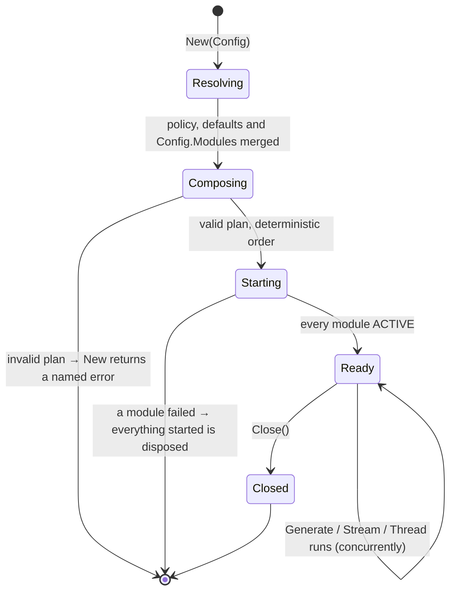
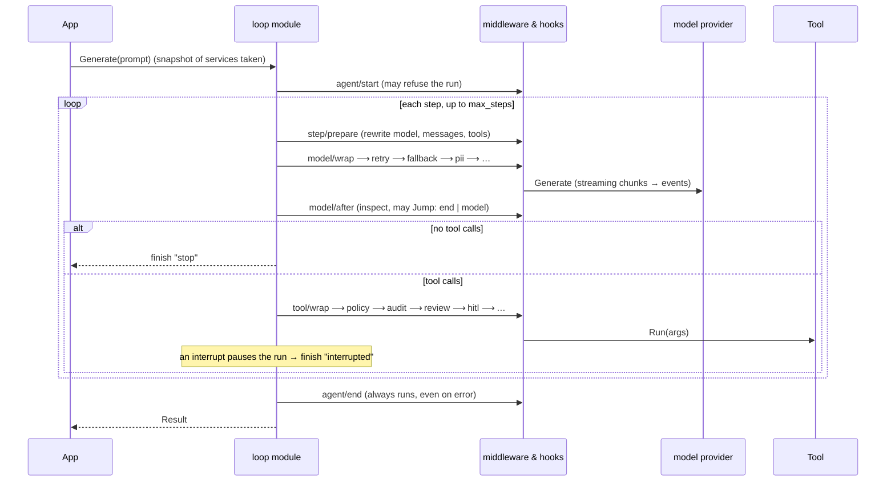
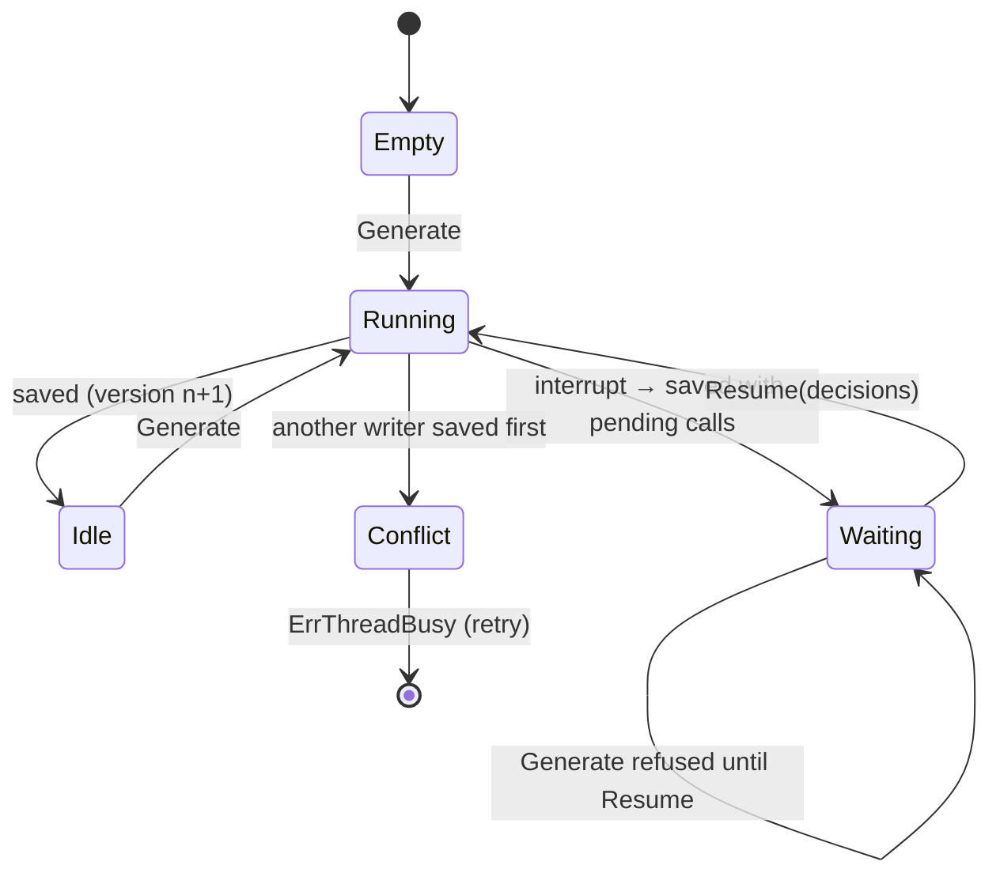
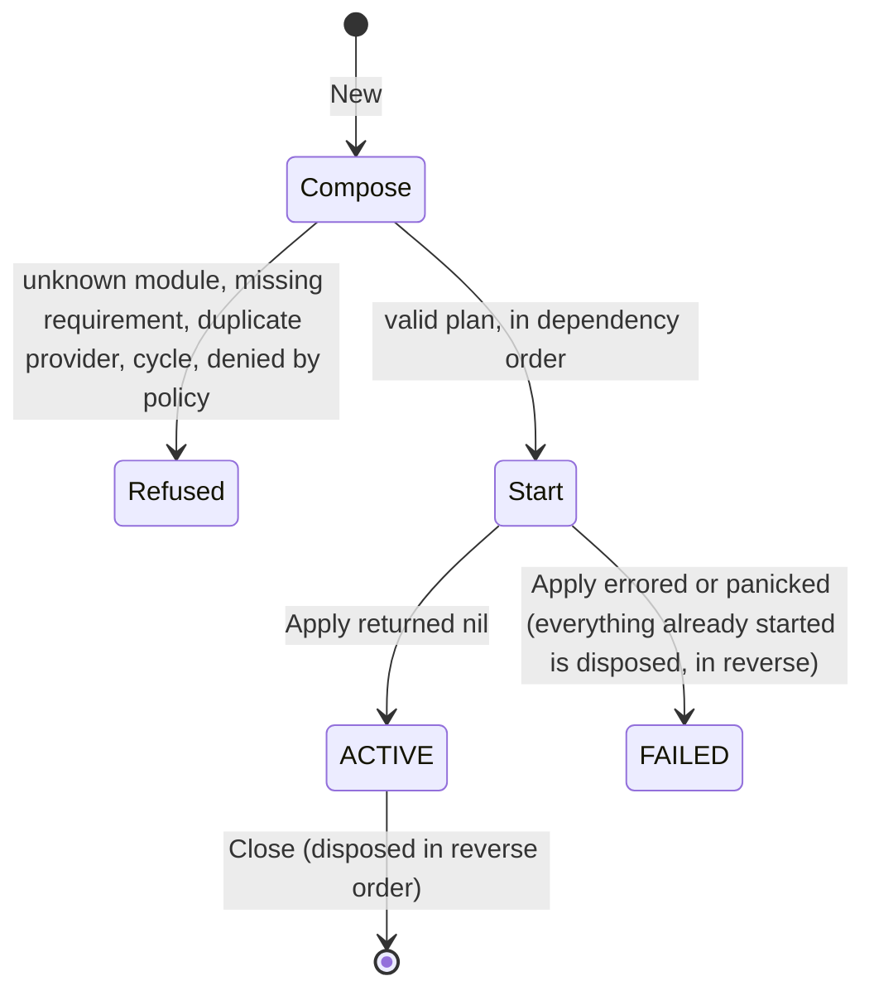

# kiln

**kiln is a statically composed, capability-secured agent SDK for Go. It is built for companies and aims to be simple to write and secure by default.**

- **Everything is a module.** The agent loop, every model provider, tools, memory, hooks, sandboxes, persistence, tracing, audit and the policy rules are compiled Go modules. There is no runtime plugin loading and no interpreted code: the application decides what is in the binary.
- **Compose at build time, validate before execution.** `kiln.New` checks the whole composition first, and fails with a named error for an unknown module, a missing requirement, a duplicate provider or a dependency cycle.
- **Easy to use.** The API looks like the [AI SDK](https://ai-sdk.dev): `Generate`, `Stream`, `GenerateObject[T]` and typed `Tool(...)`.
- **Feature rich.** It covers what [LangChain](https://docs.langchain.com/oss/python/langchain/overview) offers: many providers, a middleware pack, durable memory, human-in-the-loop, MCP, multi-agent and skills.
- **Secure by default.**
  - A module reaches the network, files, processes and databases only through the SDK broker, and only with the capabilities the policy grants.
  - A build-time check (`kiln module check`) refuses stdlib access that bypasses the broker.
  - A locked policy layer always runs first.
  - The audit log is tamper-evident.
  - Each module gets only the secrets it declares.
  - Sandboxes are pluggable, and the agent can run inside one.

## Quick start

Requires **Go 1.27**.

```bash
go get github.com/ganeshdipdumbare/kiln@v0.6.0
```

The repository is private: run `go env -w GOPRIVATE=github.com/ganeshdipdumbare/*` once, and `gh auth setup-git` (or an SSH key) so `git` can fetch it.

```go
package main

import (
	"context"
	"fmt"
	"log"

	"github.com/ganeshdipdumbare/kiln"
)

func main() {
	agent, err := kiln.New(kiln.Config{
		Model:        "mock:demo", // or "anthropic:claude-sonnet-5-5", "openai:gpt-4.1", "ollama:llama3" ...
		Instructions: "You are a concise assistant.",
	})
	if err != nil {
		log.Fatal(err)
	}
	defer agent.Close()

	res, err := agent.Generate(context.Background(), "Say hello in five words.")
	if err != nil {
		log.Fatal(err)
	}
	fmt.Println(res.Text)
}
```

`mock:demo` is an offline fake model, so this runs with no API key. For a real model, change the model string and set its key (`ANTHROPIC_API_KEY`, `OPENAI_API_KEY` …). The right provider module is enabled by itself.

**Words you'll meet** (the [glossary](https://kilnai-docs.vercel.app/#concepts) has more):

- **Module:** a compiled Go package that exports a descriptor and `func Apply(p *sdk.Scope) error`. The loop, providers, tools, memory and policy are all modules.
- **Service:** something a module provides by name for others to use: `model/anthropic`, `threads`, `memory`, `secrets`.
- **Hook:** code a module runs around each step, model call or tool call (retries, approvals, redaction …).
- **Capability:** what a module may reach through the broker: `net`, `exec`, `fs:read`, `fs:write`, `env`, `env:secrets`, `db`.
- **Run** and **thread:** one `Generate` call, and a conversation saved across runs.

**Demo:** [`examples/fullstack`](examples/fullstack) is a support desk with a Go backend and web UI: streaming, refunds that wait for a supervisor, redaction and an audit trail. Run it with `go run ./examples/fullstack`, or try it live at https://kilnai-docs.vercel.app/demo/ (the backend runs on a free instance, so the first visit can take a minute to wake it).

**Docs:** https://kilnai-docs.vercel.app has the full guide, with examples, lifecycles and reference. The content is `docs/site.html`; the design system, self-hosted fonts and interactions live in `docs/assets/` (the content is generated from the code and the examples). Every push to `main` that touches the docs or demo rebuilds the site and deploys it ([`docs.yml`](.github/workflows/docs.yml)); to build it locally, run `docs/build.sh` (add `SKIP_RECORD=1` to skip re-recording the demo).

Releases and breaking changes are listed in [CHANGELOG.md](CHANGELOG.md); see [Versioning](#versioning).

```bash
go test ./...                    # offline: the mock model needs no keys
go run ./examples/readme         # runs every example in this README
```

## Contents

1. [Quick start](#quick-start)
2. [Examples](#examples)
3. [How it works: lifecycles](#how-it-works-lifecycles)
4. [Modules](#modules)
5. [Sandboxes](#sandboxes)
6. [Security](#security)
7. [Scaling and persistence](#scaling-and-persistence)
8. [CLI](#cli)
9. [Versioning](#versioning)
10. [Status](#status)

---

## Examples

Every snippet below comes from [`examples/readme/main.go`](examples/readme/main.go). `go test` builds and runs that file with the offline mock model, so the snippets always match the API. To use a real model, replace `"mock:demo"` with a model string such as `anthropic:claude-sonnet-5-5`, `openai:gpt-4.1`, `gemini:gemini-2.5-pro`, `deepseek:deepseek-chat` or `ollama:llama3`. Set the provider's API key (`ANTHROPIC_API_KEY`, `OPENAI_API_KEY` and so on) in the environment.

**Run everything locally with [Ollama](https://ollama.com).** No API keys are needed and nothing leaves your machine:

```bash
ollama pull lfm3
go run ./examples/ollama -demo text      # also: stream, tools, object, thread, approve, shell, vision
```

The model string is just `ollama:<model>` (for example `ollama:qwen3.5:4b`). Set `OLLAMA_HOST` to use an Ollama running on another machine. See [`examples/ollama`](examples/ollama/main.go).

**Production features, each as a runnable program** (offline and no keys needed, except `examples/firecracker`, which needs Linux with `/dev/kvm`, and `examples/tensorlake`, which needs a Tensorlake API key):

| Example | Shows |
|---|---|
| [`examples/secrets`](examples/secrets/main.go) | `secrets_vault` against an in-process Vault: per-module grants, a module that can't ask as another, key rotation without a restart, a leaked key redacted from logs and audit, `secret.access` records |
| [`examples/microsandbox`](examples/microsandbox/main.go) | the agent in a [microsandbox](https://microsandbox.dev) microVM with no network (needs `msb`; set `MSB_BACKEND=cloud` and `MSB_API_KEY` for microsandbox cloud): no secret env vars in the VM, a module that holds only a placeholder, the host swapping in the real token on `GET /orders` only, the echoed token redacted, a `DELETE` and any other host refused, and the host's `sandbox.egress` record of every request |
| [`examples/firecracker`](examples/firecracker/main.go) | a self-hosted [Firecracker](https://firecracker-microvm.github.io/) microVM, created and connected to like a small hosted sandbox (Linux with `/dev/kvm`; includes a Lima setup for macOS): tap device, Firecracker API, SSH, `Config.RunIn`, and the same secret-placeholder, host-swap, redaction and `sandbox.egress` guarantees. Set `FC_HOST` to run the host process on one machine and Firecracker on another |
| [`examples/tensorlake`](examples/tensorlake/main.go) | the agent inside a real [Tensorlake](https://docs.tensorlake.ai/sandboxes/introduction) cloud sandbox (needs `TENSORLAKE_API_KEY`): the host keeps the model provider, secrets and broker, the provider runs the VM, and the same placeholder, host-swap, redaction and `sandbox.egress` flow is shown on a real hosted service |
| [`examples/observability`](examples/observability/main.go) | `audit_http` to an in-process SIEM that checks HMAC signatures and the hash chain; `trace_otlp` to an in-process OpenTelemetry collector, printing the span tree and the shared fields (`run`, `thread`, `user`, `module`, `provider`) |
| [`examples/boxprobe`](examples/boxprobe/main.go) | application modules compiled into a box program (`internal/boxtest`), the way `Config.RunIn` runs them |
| [`examples/custom-module`](examples/custom-module/main.go) | a module in its own Go package: import it, put it in `Config.Modules`, configure it with `New(...)`, and check it with `kiln module check` |

### Generate with a typed tool

```go
type WeatherIn struct {
	City string `json:"city" desc:"city name"`
}

weather := kiln.NewTool("weather", "Current weather for a city",
	func(ctx context.Context, in WeatherIn) (string, error) {
		return "18°C and light rain in " + in.City, nil
	})

agent, err := kiln.New(kiln.Config{
	Model:        "anthropic:claude-sonnet-5-5",
	Instructions: "You are a concise travel assistant.",
	Tools:        []kiln.Tool{weather},
})
defer agent.Close()

res, err := agent.Generate(ctx, "What's the weather in Lisbon?")
res.Text                 // final answer
res.Steps                // every model call with its tool results
res.ToolCalls()          // all tool calls in the run
res.Usage.TotalTokens    // token accounting
res.FinishReason         // stop | max_steps | interrupted | tool:<name>
```

The JSON Schema for the tool's arguments is derived from `WeatherIn`. The `json`, `desc` and `enum:"a,b"` tags are honoured; a field marked `omitempty` or declared as a pointer is optional. A tool can return any type: strings go to the model as they are, and everything else is sent as JSON.

### Streaming

```go
s := agent.Stream(ctx, "A haiku about Lisbon")
for delta := range s.Text() {
	fmt.Print(delta)
}
res, err := s.Result()

// Or every event: text, reasoning, tool_call, tool_result, step_start,
// step_end, interrupt, finish, error.
for e := range agent.Stream(ctx, "...").Events() {
	if e.Type == "tool_call" {
		fmt.Println("calling", e.ToolCall.Name)
	}
}
```

Breaking out of a loop early is safe: the run still completes, and `Result()` returns it.

### Structured output

```go
type Trip struct {
	City    string   `json:"city"`
	Packing []string `json:"packing" desc:"things to pack"`
	Budget  int      `json:"budget_eur,omitempty"`
}

trip, err := kiln.GenerateObject[Trip](ctx, agent, "Plan what to pack for Lisbon.")
```

How the schema reaches the model depends on the provider:

- OpenAI and Gemini use their native JSON-schema mode.
- Anthropic gets the schema as a forced tool.
- DeepSeek and Groq use JSON mode, with the schema in the prompt.

If the reply doesn't parse, kiln asks the model once to repair it and then returns `ErrNoObject`.

### Threads (durable conversations)

```go
agent, err := kiln.New(kiln.Config{
	Model:   "openai:gpt-4.1",
	Modules: kiln.Persistence("file", ".kiln"), // or kiln.Persistence("postgres", dsn)
})
th := agent.Thread("customer-42")
th.Generate(ctx, "My name is Ada.")
th.Generate(ctx, "What's my name?") // sees the earlier turn
msgs, _ := th.Messages(ctx)
```

Without `kiln.Persistence`, threads are kept in memory (`threads_inmem`).

### Human in the loop

```go
agent, _ := kiln.New(kiln.Config{
	Model:   "openai:gpt-4.1",
	Tools:   []kiln.Tool{refund},
	Modules: kiln.Approvals("refund"),
})
th := agent.Thread("ticket-981")
res, _ := th.Generate(ctx, "Refund order A-17")
for res.Interrupted() { // paused before the tool ran; the pause is saved
	in := res.Interrupts[0]
	fmt.Println("approve?", in.Message, in.ToolCall.Args)
	res, _ = th.Resume(ctx, []kiln.Decision{kiln.Approve(in.ID)}) // or Reject(id, why) / Edit(id, args) / Respond(id, text)
}
```

The pause is saved with the thread. With `threads_sql`, a different process or pod can resume it, possibly hours later. Two other ways to answer interrupts:

- **Without a thread:** call `agent.Resume(ctx, res, decisions)`. The state travels in `res`.
- **In-process, synchronously:** add `kiln.Approver(func(ctx, in) (*Decision, error))...` to `Config.Modules`, for example to prompt in a CLI.

To pause on everything risky instead of naming tools, use `{"non_readonly": true}` or `{"risk": ["high"]}`. You can also put `hook_review` in front: a reviewer model then approves, denies or escalates each call to a human.

### Hooks from the standard modules

```go
agent, _ := kiln.New(kiln.Config{
	Model: "anthropic:claude-sonnet-5-5",
	Modules: []kiln.Module{
		hook_retry.New(map[string]any{"max_retries": 3}),                      // 429/5xx with backoff
		hook_fallback.New(map[string]any{"models": []any{"openai:gpt-4.1"}}),   // next model on failure
		hook_limits.New(map[string]any{"model_calls_run": 20, "tool_calls_run": 50}),
		hook_pii.New(map[string]any{"types": []any{"email", "credit_card"}}),   // redact, mask, hash or block
		hook_summarize.New(map[string]any{"trigger_messages": 40, "keep_messages": 10}),
	},
})
```

### Your own hooks

A module is ordinary Go code compiled into your program (see [Modules](#modules)).

```go
timing := kiln.Module{Name: "timing", Apply: func(p *sdk.Scope) error {
	p.WrapModel(func(c context.Context, req *kiln.ModelRequest, next kiln.ModelHandler) (*kiln.ModelResponse, error) {
		resp, err := next(c, req) // the model call, plus any inner hooks
		if err == nil {
			p.Logf("%s step %d used %d tokens", req.Model, req.Step, resp.Usage.TotalTokens)
		}
		return resp, err
	})
	p.WrapTool(func(c context.Context, req *kiln.ToolRequest, next kiln.ToolHandler) (*kiln.ToolResult, error) {
		if req.Call.Name == "drop_database" {
			return &kiln.ToolResult{Content: "not allowed", IsError: true}, nil
		}
		return next(c, req)
	})
	return nil
}}
agent, _ := kiln.New(kiln.Config{Model: "openai:gpt-4.1", Modules: []kiln.Module{timing}})
```

### Add your own modules

Application modules are compiled into your binary and composed with the standard ones. Declare what they need, what they provide and which capabilities they use; `New` validates all of it before anything runs.

```go
console := kiln.Module{
	Name:     "console",
	Requires: []string{"memory"},                 // must exist first ("?svc" = optional)
	Provides: []string{"tool/console"},           // only these names may be provided
	Permissions: []string{"net"},                 // broker capabilities: net, exec, fs:read, fs:write, env, env:secrets, db
	Apply: func(p *sdk.Scope) error {
		hc, err := p.HTTP(sdk.HTTPOptions{AllowHosts: []string{"api.example.com"}})
		if err != nil {
			return err
		}
		return p.AddTool(sdk.Tool{Name: "lookup", Schema: sdk.Object(map[string]any{"id": sdk.Str("id")}, "id"),
			Run: func(c context.Context, args map[string]any) (string, error) {
				req, _ := http.NewRequestWithContext(c, "GET", "https://api.example.com/"+sdk.ArgString(args, "id"), nil)
				resp, err := hc.Do(req)
				if err != nil {
					return "", err
				}
				defer resp.Body.Close()
				b, _ := io.ReadAll(resp.Body)
				return string(b), nil
			}})
	},
}

agent, err := kiln.New(kiln.Config{
	Model:   "openai:gpt-4.1",
	Modules: []kiln.Module{console},
})
```

A module is an ordinary Go package, so it can live in another directory, another package or another Go module. Import it and put its value in `Config.Modules`; `go get` and `replace` work as usual. There is one way to compose: the slice. A module's `New(...)` constructor returns it configured, and its `As` field names a second instance.

If you already have a Go library, write a thin `engine.Module` adapter whose `Apply` exposes its functions as tools or services; the library itself does not need to change. See [MODULES.md](MODULES.md) and the [Custom modules](https://kilnai-docs.vercel.app/#custom-modules) docs page.

A missing requirement names the registry modules that would supply it, so the fix is one line:

```text
kiln: module console requires "memory", which no enabled module provides (add one of: memory_file, memory_inmem, memory_sql)
```

Modules reach the outside world only through the broker: `p.HTTP`, `p.Listen`, `p.Dir`, `p.Exec`, `p.Env` and `p.DB`. Each call is refused with the missing capability name when the policy does not grant it. `p.Dir` roots file access with `os.Root`, so `..` and absolute symlinks cannot escape; `p.Exec` starts named programs without a shell.

### Subagents and handoffs

```go
agent, _ := kiln.New(kiln.Config{
	Model: "openai:gpt-4.1",
	Modules: []kiln.Module{
		tool_time.New(),
		tool_subagents.New(map[string]any{"agents": []any{
			map[string]any{"name": "researcher", "description": "Finds facts",
				"instructions": "Research carefully.", "tools": []any{"current_time"}}, // called as a tool
			map[string]any{"name": "billing", "description": "Invoices and refunds",
				"instructions": "You are billing support.", "mode": "handoff"}, // takes over the thread
		}}),
	},
})

// A whole agent, with its own modules, model and policy, can also be a tool:
Config.Tools: []kiln.Tool{expertAgent.AsTool("legal_expert", "Answers legal questions")}
```

### Shell and file tools in a sandbox

```go
agent, _ := kiln.New(kiln.Config{
	Model: "openai:gpt-4.1",
	Modules: append(kiln.Sandbox("docker"), // or sandbox_local, or your own
		workspace_sandbox.New(map[string]any{"provider": "docker"}), // one box per thread, no network
		tool_shell.New(), tool_fs.New()),
})
res, _ := agent.Generate(ctx, "Write notes.md and count its lines")
for _, ch := range res.Changes { // review what the agent changed
	fmt.Print(ch.Diff())
}
```

### MCP servers, skills, the web

```go
modules := []kiln.Module{
	tool_mcp.New(map[string]any{"servers": []any{
		map[string]any{"name": "github", "command": "github-mcp-server", "args": []any{"stdio"},
			"env": map[string]any{"GITHUB_TOKEN": "secret://GITHUB_TOKEN"}},
		map[string]any{"name": "docs", "url": "https://mcp.internal.example.com/mcp"},
	}}), // tools appear as github__create_issue, docs__search, ...
	tool_skills.New(map[string]any{"dirs": []any{"./skills"}}), // folders with SKILL.md
	tool_fetch.New(map[string]any{"allow_hosts": []any{"*.wikipedia.org"}}),
}
modules = append(modules, kiln.WebSearch("duckduckgo")...) // tool_websearch; also tavily, brave, searxng
```

### Reasoning, caching and structured output

```go
modules = append(modules, kiln.Thinking("high")...) // hook_thinking: Anthropic adaptive thinking, OpenAI reasoning_effort, Gemini thinkingConfig
modules = append(modules,
	hook_cache.New(map[string]any{"ttl": "1h"}),               // prompt caching (Anthropic cache_control, OpenAI prompt_cache_key)
	hook_output_validate.New(map[string]any{"max_retries": 2})) // re-ask when GenerateObject output doesn't match the schema
```

### Long runs, guardrails and evals

```go
modules = append(modules, []kiln.Module{
	hook_compact.New(map[string]any{"max_fraction": 0.8}), // stay inside the context window, cheapest first
	tool_search.New(map[string]any{"threshold": 15}),      // reveal tools on demand (big MCP servers)
	tool_plan.New(), hook_loop_detect.New(), hook_tool_output_limit.New(),
	hook_guardrails.New(map[string]any{"rules": []any{
		map[string]any{"on": "output", "detect": "secrets", "action": "redact"},
	}}),
}...)
// a crash keeps the run's progress; Thread.Continue resumes it
cfg := kiln.Config{Model: "openai:gpt-4.1", Modules: modules, SaveEachStep: true}
```

`agent.Thread(id).Fork(ctx, newID)` copies a conversation to try another direction. `kiln eval cases.json` (or package [`evals`](evals/evals.go)) grades the agent on a dataset of prompts.

### Scheduled jobs and webhooks

```go
Config.Modules: []kiln.Module{
	trigger_schedule.New(map[string]any{"jobs": []any{
		map[string]any{"name": "weekly-report", "schedule": "weekly fri 17:00", "prompt": "Summarize this week's tickets", "user": "ops"},
	}}), // the model also gets schedule_create / schedule_list / schedule_cancel
	trigger_webhook.New(map[string]any{"routes": []any{
		map[string]any{"path": "/github", "secret": "secret://GH_WEBHOOK_TOKEN", "thread": "gh-{repository.full_name}"},
	}}), // requests must carry an HMAC-SHA256 signature
}
```

### Configuration is Go

There is no profile file: the composition is the `Config.Modules` slice and
the settings are fields, so the compiler checks both and there is only one
place to look. Secrets stay references (`secret://NAME`) resolved at run
time.

A policy JSON can still be loaded by the application (`engine.ReadJSON`) and
passed as `Config.Policy`; the admin policy is the only layer that can narrow
what a module declared.

---

## How it works: lifecycles

### Agent lifecycle



**`New`:**

1. **Resolve the configuration.** `Config.Modules` and the defaults combine into one list of module rows, with the policy (secure by default) applied. Defaults give way to a module of the same family: `threads_sql` replaces `threads_inmem`, for example.
2. **Add the defaults a requirement needs.** If a required service has no provider, the facade adds its standard provider and marks it `auto`. There is no runtime loading.
3. **Compose.** `engine.Compose` validates the whole plan without running any module: unknown modules, policy allow/deny, duplicate providers, missing requirements (with a hint naming the modules that would supply it) and cycles. It returns a deterministic start order; policy-required rows (audit, policy, secrets) start in the order the policy lists them.
4. **Start.** Modules `Apply` in that order. If one fails or panics, everything already started is disposed in reverse and `New` returns the error. You never get a half-configured agent.

**Ready:** an agent is safe for concurrent use. Each run takes a snapshot of the current services and keeps it.

**`Close`:** disposes every module in reverse start order, running each one's cleanups. The effects:

- Sandboxes are destroyed.
- Jobs and webhook runs are cancelled and awaited.
- MCP server processes are stopped.
- Database pools are closed.
- `Close` is idempotent: calling it twice is safe.

### Run lifecycle (one `Generate` / `Stream` / `Resume`)



Step by step:

1. **Start.**
   - The facade builds the run state: history, the new user message, model, instructions and the user's identity.
   - It takes a **snapshot** of the services, so the run is stable even if the composition changes later.
   - It hands the run to the `loop` service, which is itself a module.
   - **`agent/start`** hooks run. An error from one refuses the run.
2. **Resume (only when resuming).** Pending tool calls run first, using the decisions you supplied:
   - `approve` runs the call.
   - `edit` runs it with your arguments.
   - `reject` and `respond` send your text to the model instead of running the tool.
3. **Each step**, up to `max_steps` (default 20):
   1. **Build the request.** The system prompt is the instructions plus the skill prompts. The tools are the registered tools plus any per-run tools.
   2. **`step/prepare`** hooks may rewrite the model, messages, tools or tool choice. Summarization and handoffs work this way.
   3. **`model/wrap`** middleware runs as an onion, highest priority outermost, around the provider call. Retry, fallback, PII redaction, limits, audit and tracing live here. Streaming chunks become `text` and `reasoning` events.
   4. **`model/after`** hooks inspect the reply. They can set `Jump`: `"end"` stops the run, `"model"` asks the model again.
   5. **No tool calls** means the run finishes with `stop`.
   6. **Tool calls:** each one runs through **`tool/wrap`**, as an onion with the highest priority outermost. Then the tool runs. Tools run one at a time, or in parallel with `parallel_tools`.
      - A plain error goes back to the model as the tool result, so it can recover.
      - `sdk.Fatal(err)` aborts the run.
      - A returned **interrupt** pauses the run. If an `approver` service is loaded, it can decide on the spot. Otherwise the run finishes `interrupted`, and the pending calls are kept in the run state, or in the thread when there is one.
   7. If a tool listed in `StopOnTool` was called, the run finishes with `tool:<name>`.
4. **Stop.** Reaching the step limit finishes the run with `max_steps`.
5. **End.** **`agent/end`** hooks always run exactly once, even when the run fails (`FinishReason: "error"`), so modules can always clean up. Observers then get `finish`, or `error` when the run failed.

Default priorities (higher means outer). Set `Priority` on the module value to override a value; the reserved band is only for locked modules.

| Priority | Model middleware (`model/wrap`) | Tool middleware (`tool/wrap`) |
|---|---|---|
| reserved band | `audit_file`, `policy` (when locked) | `audit_file`, `policy` (when locked) |
| 30 | `hook_pii` | `hook_pii` |
| 20 | `hook_fallback` | |
| 10 | `hook_retry` | `hook_retry` (`tool_retries`) |
| 0 | `hook_limits`, `hook_log`, `trace_file`, your modules (in start order) | `hook_review`, `hook_limits`, `hook_log`, `trace_file`, your modules |
| −10 | | `hook_approval` (innermost, so reviewers and policy decide first) |

Events in order: `step_start`, then the `text`/`reasoning` deltas, `step_end`, `tool_call`, and `tool_result` or `interrupt`, repeated for each step; then `finish` or `error`. `OnEvent` and `Stream.Events()` see the same events.

### Thread lifecycle



Each turn goes through four steps:

1. **Load** the state (messages, pending interrupts, run values such as the active handoff agent or the sandbox id) from the `threads` service.
2. **Run** the turn.
3. **Save** with optimistic versioning. If another process saved first, you get `ErrThreadBusy` and nothing is lost.
4. **Wait on pauses.** A thread with pending interrupts accepts only `Resume`.

Any process that shares the thread storage can continue any thread.

### Module lifecycle

Modules are compiled and composed, not loaded at runtime. The lifecycle is the application's:



- **Compose is pure.** It runs no module code. It checks names, the policy allow/deny lists, declared capabilities against the policy's grants, every required service against the enabled providers, duplicate providers, and cycles, then produces a deterministic start order. Policy-required rows start in the order the policy lists them, so an `audit_file` listed first sees everything after it.
- **Start is all-or-nothing.** A failed `Apply` disposes every module already started, so `New` never returns a half-built agent.
- **Dispose.** Everything a module registered through its context is undone in reverse order: tools, services, hooks, skills and `Effect` cleanups.
- **No hot reload.** Change a module, rebuild, redeploy.

### Sandbox lifecycle (`workspace_sandbox`)

1. **Created lazily**, the first time a shell or file tool runs in a thread. Each thread gets its own box.
2. **Reused** for every later turn of that thread.
3. **Remembered.** The box id is saved in the thread at the end of each run.
4. **Re-attached** when the thread resumes in a new process.
5. **Destroyed** after `idle_ttl_seconds`, or when the agent closes.

With `tool_sandbox`, the model creates and destroys boxes itself, up to `max_boxes` per thread.

### Remote agent lifecycle (`Config.RunIn`)

1. `New` builds a small **host** agent. It holds the model provider and its keys, the sandbox provider, and your Go tools.
2. The host creates a box and uploads the program (its own binary by default, or `RunIn.Binary` built for the box's OS and architecture), plus the resolved module rows and admin policy.
3. The host starts the program with `KILN_BOX=1`; the program calls `kiln.ServeBox` (check `kiln.InBox()` first) and serves the agent over JSON-RPC on stdin/stdout. Its own modules come with it, compiled in.
4. The box builds its agent and replies `ready`, or reports the startup error.
5. Runs and threads are proxied over JSON-RPC. Model calls come back to the host, through the host's middleware and policy, so keys never enter the box. Your Go tools are bridged back too.
6. `Close` stops the process, destroys the box and closes the host agent.

`RunIn.Provider: "local"` is refused unless `RunIn.AllowUnsafeLocal` is set: it is a host process, not an isolation boundary. `RunIn.BridgedTools` limits which host Go tools the box can call, and `RunIn.AllowPrivateEgress` opts into loopback/RFC1918 egress from the host broker (off by default, like `tool_fetch`).

---

## Modules

Everything the agent does comes from a module, and **there is one way to compose**: put module values in `Config.Modules`. Presets are just preconfigured modules, and plumbing (the loop, a workspace for shell tools, the database connection) is resolved statically and shows as `auto` in `agent.Status()`:

```go
modules := append(kiln.Approvals("issue_refund"),          // hook_approval
	kiln.Persistence("postgres", "secret://DATABASE_URL")...) // threads_sql + memory_sql + db_sql
modules = append(modules, kiln.Sandbox("docker")...)       // sandbox_docker + workspace_sandbox
modules = append(modules, kiln.Audit("/var/log/kiln/audit.log")...)
modules = append(modules, kiln.Tracing("http://otel-collector:4318")...)
modules = append(modules, kiln.MCP("github", "npx", "-y", "@modelcontextprotocol/server-github")...)

agent, _ := kiln.New(kiln.Config{
	Model:   "anthropic:claude-sonnet-5-5", // model_anthropic
	Modules: modules,
})
```

**A module is one Go package.** It exports a descriptor and an `Apply` function, and it can live in your app or in another Go module. `Provides` and `Permissions` are enforced: `Provide` of a name that is not declared fails, and a broker call without the capability fails.

| You want… | Call |
|---|---|
| the model to be able to do something | `p.AddTool` |
| something to happen around every model or tool call | `p.WrapModel`, `p.WrapTool`, `p.OnRunStart` … |
| other modules to use something you provide | `p.Provide("model/acme", …)` |
| background work, stopped on close | `p.Effect`, `p.OnClose` |
| the network, files, processes, env, the database | `p.HTTP`, `p.Listen`, `p.Dir`, `p.Exec`, `p.Env`, `p.DB` |

```go
package greeter

import (
	"context"

	"github.com/ganeshdipdumbare/kiln/engine"
	"github.com/ganeshdipdumbare/kiln/sdk"
)

var Module = engine.Module{
	Name:        "greeter",
	Requires:    nil,          // "?secrets" if optional, "model/*" for any one
	Provides:    nil,          // services Apply will register
	Permissions: nil,          // net, exec, fs:read, fs:write, env, env:secrets, db
	Apply: func(p *sdk.Scope) error {
		return p.AddTool(sdk.Tool{
			Name: "greet", Description: "Greet someone",
			Schema: sdk.Object(map[string]any{"name": sdk.Str("who")}, "name"),
			Run: func(c context.Context, args map[string]any) (string, error) {
				return "Hello, " + sdk.ArgString(args, "name"), nil
			},
		})
	},
}
```

Import the package and put it in the list: `Modules: []kiln.Module{greeter.Module}`.

`kiln module list` prints every standard module with its services and capabilities, and `kiln module manifest` prints the same as JSON for a build manifest. `kiln module check [dir]` is the CI gate: it rejects a module that imports `os`, `os/exec`, `net` (except pure helpers), `syscall` or `database/sql` instead of the broker, uses a capability it did not declare, provides an undeclared service, or ships a descriptor that does not match its directory.

A note on what this buys: compile-time inclusion is not a sandbox. A malicious module linked into your binary still runs with the process's privileges. The analyzer and the broker enforce the contract at build time and at the API boundary; run genuinely untrusted code in a sandbox (`Config.RunIn`).

### Standard modules (linked into the binary)

Named by what they do. The prefix is a convention for the modules we ship, not a rule for yours.

| Kind | Modules |
|---|---|
| Tools: the model can call them | `tool_shell`, `tool_fs`, `tool_fetch`, `tool_websearch`, `tool_search`, `tool_plan`, `tool_time`, `tool_memory`, `tool_mcp`, `tool_subagents`, `tool_skills`, `tool_sandbox` |
| Hooks: run around calls | `hook_retry`, `hook_fallback`, `hook_limits`, `hook_summarize`, `hook_thinking`, `hook_cache`, `hook_output_validate`, `hook_compact`, `hook_guardrails`, `hook_loop_detect`, `hook_tool_output_limit`, `hook_approval`, `hook_review`, `hook_pii`, `hook_tool_errors`, `hook_log`, `hook_guard`, `hook_stats` |
| Model providers | `model_openai` (OpenAI, DeepSeek, Ollama, vLLM, OpenRouter, Groq), `model_anthropic`, `model_gemini`, `model_mock` |
| Threads and memory | `threads_inmem` / `_file` / `_sql`, `memory_inmem` / `_file` / `_sql`, `db_sql` |
| Sandboxes and workspaces | `sandbox_local`, `sandbox_docker`, `sandbox_microsandbox`, `workspace_local`, `workspace_sandbox` |
| Triggers | `trigger_schedule`, `trigger_webhook` |
| Telemetry and audit | `trace_file`, `trace_otlp`, `audit_file`, `audit_http` |
| Secrets | `secrets_env`, `secrets_vault` |
| Policy and the loop | `policy`, `loop` |

A model string `provider:model` enables the matching provider automatically. The prefixes are `openai`, `deepseek`, `anthropic`, `gemini`/`google`, `ollama`, `openrouter`, `groq` and `mock`.

### From v0.4

v0.5 removed the runtime plugin system: interpreted plugins, the plugin store, signed packages, lock-file pins and hot reload. Every `*_test.go` suite was ported, and the standard modules were converted to Go packages under [`modules/`](modules). The old short names (`llm_*`, `mw_*`, `checkpoint_*`, `store_*`, `exec_*`, `jobs`, `audit_jsonl`, `agents`, `memory_store`) are **gone**; [CHANGELOG.md](CHANGELOG.md) lists old → new and the option renames.

## Sandboxes

There are two directions:

- **The agent uses sandboxes.** Load `workspace_sandbox`, and the shell and file tools run in a per-thread box. Load `tool_sandbox`, and the model can start boxes on demand.
- **The agent runs inside a sandbox:**

  ```go
  kiln.New(kiln.Config{
  	Model:   "openai:gpt-4.1",
  	Modules: []kiln.Module{tool_shell.New(), tool_fs.New()},
  	RunIn:   &kiln.RunIn{Provider: "docker", Binary: "./box-linux"}, // GOOS=linux go build -o box-linux ./your/box/program
  })
  ```

Providers: `sandbox_local` (no isolation, for development; `Config.RunIn` refuses it unless `AllowUnsafeLocal` is set), `sandbox_docker` (Docker or Podman, with no network by default) and `sandbox_microsandbox` ([microsandbox](https://microsandbox.dev) microVMs, with no network by default). The microsandbox provider also runs on **microsandbox cloud** when the host environment sets `MSB_BACKEND=cloud` and `MSB_API_KEY` (or selects a cloud profile with `MSB_PROFILE`); no code changes are needed. Any other backend, such as Firecracker, E2B or Kubernetes, only needs to provide `sdk.SandboxProvider`. See [`examples/custom-sandbox`](examples/custom-sandbox) and the complete self-hosted microVM provider in [`examples/firecracker`](examples/firecracker). The `Config.RunIn` + `SecretHosts` flow is the same for a hosted provider: the host runs the broker and secrets, and the provider's machine only receives placeholders. The Firecracker example walks that flow explicitly and has a [cloud-hosted equivalent](examples/firecracker/README.md#the-same-flow-on-a-cloud-hosted-sandbox).

## Security

`kiln.New()` composes with the **secure** policy:

- A module gets exactly the capabilities it declares and nothing else; a policy file can narrow that further.
- Broker calls fail closed, naming the missing capability.
- A module can resolve only the secrets it declares (or that the application writes as `secret://NAME` in its config); literal credentials are still redacted.
- Credential-bearing HTTP clients refuse redirects, and non-loopback plaintext endpoints need an explicit `allow_insecure: true`.
- `kiln module check` refuses stdlib access that bypasses the broker.

An admin `policy.json` adds:

- locked `policy` and `audit_file` modules, which start first;
- the approval mode: read-only, workspace-write or full-access;
- tool and model allowlists, token budgets and per-role rules;
- per-module secret grants and capability grants.

`Config.RunIn` keeps the model and secret providers on the host, returns placeholders in the box, refuses redirects on proxied HTTP, blocks private/metadata egress by default, authenticates the box's run identity for `host.llm`/`host.tool`, and redacts persisted threads and memory. See [SECURITY.md](SECURITY.md).

## Scaling and persistence

The core engine is stateless and needs no database. All state lives behind module services: `threads`, `memory`, `audit` and `jobs`. For multiple replicas:

```go
import _ "github.com/ganeshdipdumbare/kiln/drivers/postgres"

Config.Modules = kiln.Persistence("postgres", "secret://KILN_DATABASE_URL") // db_sql + threads_sql + memory_sql
```

With this setup:

- Any replica can serve any thread.
- A human approval paused on one pod can be resumed on another.
- Concurrent writes return `ErrThreadBusy` instead of overwriting each other.

## CLI

The `kiln` command runs the **standard modules**. Application modules are compiled into your own program; put them in `Config.Modules`.

```bash
go run ./cmd/kiln -model openai:gpt-4.1 -use tool_time      # REPL (/modules, /quit)
go run ./cmd/kiln run -model mock:x "hello"                 # one prompt; -json, -thread ID
go run ./cmd/kiln eval -model ... cases.json                # grade on a dataset
go run ./cmd/kiln config dump -model mock:demo -use tool_time  # policy + modules in start order
go run ./cmd/kiln module list                               # every standard module
go run ./cmd/kiln module check modules                      # static check (CI gate)
go run ./cmd/kiln module manifest modules > manifest.json   # modules, services, capabilities
go run ./cmd/kiln trace view .kiln/trace.jsonl > trace.html
go run ./cmd/kiln audit verify .kiln/audit.jsonl
```

`serve` (the box side) is started by `Config.RunIn` itself: the box runs the same program with `KILN_BOX=1`; a program calls `kiln.ServeBox` when `kiln.InBox()` is true.

## Versioning

kiln follows [semantic versioning](https://semver.org) with git tags (`v0.5.0`). The Go module is `github.com/ganeshdipdumbare/kiln`. `sdk.Version` holds the version the code reports.

While the major version is 0:

- **Patch releases** (`v0.5.x`) fix bugs and security issues without breaking the public API.
- **Minor releases** (`v0.x.0`) may break it. Every break is listed under "Breaking changes" in [CHANGELOG.md](CHANGELOG.md), with what to change.

The public API is:

- the `kiln` package (`New`, `Config`, `Run`, `Generate` / `Stream` / `Thread` ...);
- `sdk`, which modules are written against;
- `engine`'s exported types (`Module`, `Policy`, `Compose`, `Plan`);
- `audit` and the audit record format;
- the `kiln` CLI commands and flags;
- the names and config keys of the standard modules, and the `Config`/`Run` fields.

To depend on a version, `go get github.com/ganeshdipdumbare/kiln@vX.Y.Z`. To try unreleased work, `go get github.com/ganeshdipdumbare/kiln@main`, or a local checkout with `replace github.com/ganeshdipdumbare/kiln => ../kiln`.

## Status

**Done, with tests:**

- the static composer: validation (unknown module, missing requirement, duplicate provider, cycle), deterministic order, all-or-nothing startup
- the capability broker: HTTP with host allow-lists and SSRF checks, rooted directories, exec without a shell, env, database
- the build-time analyzer (`internal/modulecheck`) and the `kiln module` commands
- the facade (`New`, `Config`, `Run`, `Generate`, `Stream`, `Thread`)
- four model providers
- streaming and structured output
- the middleware pack
- threads (in-memory, file and Postgres)
- human-in-the-loop, including across processes
- MCP (stdio and HTTP)
- subagents and handoffs
- skills
- both sandbox directions (local and Docker)
- policy, audit and secrets
- tracing and the viewer
- jobs and webhooks
- the CLI
- secret redaction, caller-bound secrets and `secret.access` auditing
- `secrets_vault`, `audit_http`, `trace_otlp`

**Not yet built:**

- agent teams (a shared task board)
- a first-class out-of-process module for genuinely untrusted code
- a KMS-backed secrets provider (write one against `sdk.Secrets`)
- `jobs_sql`
- `kiln serve --http`
