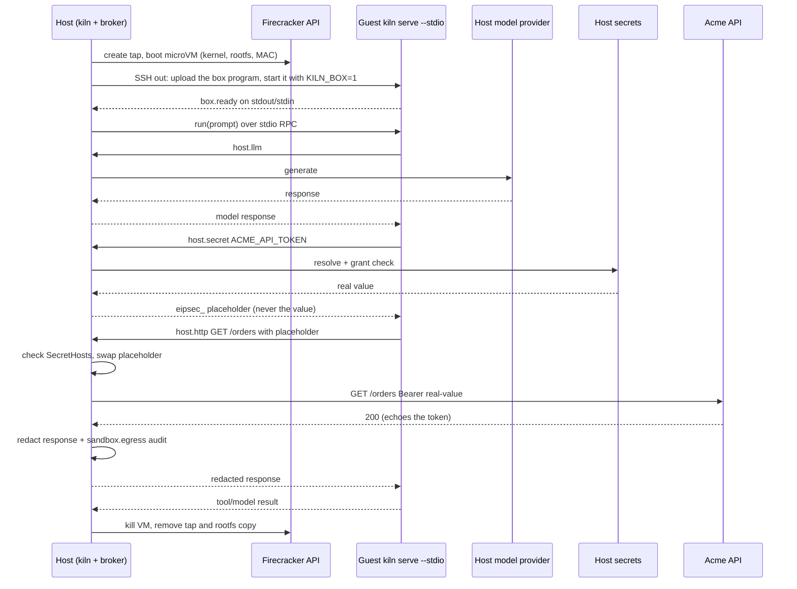

# Firecracker sandbox example

This example self-hosts a [Firecracker](https://firecracker-microvm.github.io/)
microVM and connects to it like a small hosted sandbox. The provider:

- creates a tap device and starts Firecracker with the API over a Unix socket;
- boots an Ubuntu rootfs from the Firecracker CI;
- connects to the guest over SSH for exec, files and `kiln serve --stdio`;
- destroys the VM, tap and temporary rootfs on `Close`.

The agent runs inside the microVM with `Config.RunIn`. The real test token stays on
the host, the guest holds a placeholder, and the host swaps it only for the
allowed request.

## What runs where

```
your server / Lima VM (the host)
  ├── kiln host process: model provider, secrets, broker, audit
  └── Firecracker microVM (the sandbox)
        └── the box program (ServeBox) + modules + tools
```

The host and the sandbox are separate kernels and process trees. They are only
on the same machine in this local demo because Lima provides the Linux/KVM
host. The link is still SSH over virtio-net to the guest, not a host-local
shortcut. In a real deployment the host is your server and the Firecracker VM
(or a hosted sandbox service) runs somewhere else; the provider connects to
that remote host, but the host-to-guest RPC flow is unchanged.

## How the host and sandbox know each other

The host knows the sandbox through the provider: the Firecracker API socket and
the guest IP on the tap network. The sandbox does **not** know the host. The
host connects out (SSH in this example), starts `kiln serve --stdio`, and keeps
that process's stdin/stdout. All `host.*` calls are RPC frames on that stream.



The guest never dials the host and is never given a host address. It only has
the stdin/stdout stream the host opened; that is why no inbound port is needed
and why a fake sandbox cannot reach the host.

## How a secret is redeemed

1. `examples/firecracker/main.go` keeps the real `ACME_API_TOKEN` in the host
   environment and allows it only for `GET 127.0.0.1/orders*` in
   `RunIn.SecretHosts`.
2. The `call_api` module inside the VM runs `p.Secret("secret://ACME_API_TOKEN")`.
   That request goes through the box's `secrets` service to the host.
3. `remote.go` handles it as `host.secret` and calls
   `broker.placeholder` (`broker.go`). The broker resolves the value on the
   host, checks the module's grant and audits it, and returns a fresh
   `eipsec_...` placeholder. The value never crosses into the VM.
4. The module sends an HTTP request containing the placeholder. The box's
   HTTP is relayed to the host as `host.http`; `broker.fetch` (`broker.go`)
   finds the placeholder, checks the method/host/path against `SecretHosts`,
   resolves the real value, swaps it into the URL/headers/body, and makes the
   request from the host.
5. The response is redacted with `sdk.Redact` before it goes back to the VM,
   and the request is recorded as `sandbox.egress` (allowed or denied).

That is why the example output shows a placeholder in the sandbox, the real
token at the Acme API, and `[REDACTED]` in the reply.


## Host on macOS, Firecracker in Lima

This is the real separation: the kiln host process runs on macOS, while the
Firecracker VMM and the guest microVM run inside the Lima VM. The provider
starts Firecracker over SSH and reaches the guest with an SSH `ProxyJump`; the
host process, model keys and secrets never run inside Lima.

```bash
# once, inside Lima
limactl shell firecracker
cd /Users/$(whoami)/code/kiln
sudo env PATH=/usr/local/go/bin:$PATH examples/firecracker/setup.sh

# on macOS: host process here, Firecracker in Lima
FC_HOST=lima-firecracker \
FC_SSH_CONFIG="$HOME/.lima/firecracker/ssh.config" \
go run ./examples/firecracker
```

The output starts with:

```text
Host process: darwin/... (model, secrets, broker live here)
Firecracker host: lima-firecracker (VMM and microVM live there)
```

`limactl show-ssh firecracker` prints the equivalent of
`ssh -F ~/.lima/firecracker/ssh.config lima-firecracker`. The guest SSH key,
kernel and rootfs are shared through the writable Lima mount. For another
remote host, run `setup.sh` there, make its kernel/rootfs/key paths available
to the host process, and set `FC_HOST` and `FC_SSH_CONFIG` to its SSH target.

## The same flow on a cloud-hosted sandbox

Firecracker is the runnable stand-in for a hosted service. The host/sandbox
split does not depend on who owns the machines: only the provider module
changes.

```go
agent, _ := kiln.New(kiln.Config{
    Model:   "openai:gpt-4.1",
    Modules: []kiln.Module{tool_shell.New(), tool_fs.New()},
    RunIn: &kiln.RunIn{
        Provider: "your_hosted_provider", // e.g. E2B, microsandbox cloud, a Kubernetes provider
        Binary:   "./kiln-linux",
        // The real values stay in the host's environment. The provider's
        // machine only ever receives placeholders.
        SecretHosts: map[string][]string{
            "ACME_API_TOKEN": {"GET api.acme.com/orders*"},
        },
    },
})
```

The host is your server: it runs the model provider, the secrets service, the
broker and the audit sink. The sandbox is the provider's machine. When the
module in that sandbox asks for a secret, the host answers with a placeholder;
when the sandbox sends a request with that placeholder, the host checks
`SecretHosts`, swaps in the real value, makes the request from the host and
redacts the reply. The provider never sees the value.

That is why `examples/firecracker` is useful even if you use a hosted service:
it runs the exact same `Config.RunIn`, `host.secret`, `host.http`, placeholder,
redaction and `sandbox.egress` code paths, with a provider you can inspect and
run yourself.

## Requirements

- Linux with `/dev/kvm` (x86_64 or aarch64) and passwordless `sudo -n`.
- `curl`, `wget`, `ssh`, `ssh-keygen`, `unsquashfs`, `mkfs.ext4`, `ip`.
- Go 1.27+.

### macOS (Apple Silicon M3 or newer, macOS 15+)

Firecracker cannot run on macOS directly. Run it inside a Lima VM with nested
virtualization:

```bash
brew install lima
limactl create --name firecracker --tty=false \
  --vm-type=vz --nested-virt --arch=aarch64 \
  --cpus=4 --memory=6 --disk=30 --mount-writable template:ubuntu
limactl start --tty=false firecracker
limactl shell firecracker -- test -e /dev/kvm && echo "KVM OK"
```

Install Go in the VM if needed, then run the example there:

```bash
limactl shell firecracker
cd /Users/$(whoami)/code/kiln   # the writable Lima mount
sudo env PATH=/usr/local/go/bin:$PATH examples/firecracker/setup.sh
export PATH=/usr/local/go/bin:$PATH
go run ./examples/firecracker
```

## Linux

```bash
sudo examples/firecracker/setup.sh
go run ./examples/firecracker
```

The setup script downloads the latest Firecracker CI kernel and Ubuntu rootfs,
adds a local SSH key, builds `rootfs.ext4`, installs `firecracker` in
`/usr/local/bin`, and writes everything under `.kiln/firecracker`
(gitignored). The example uses `sudo -n` for the tap device and Firecracker.

## Configuration

The provider reads these environment variables:

| Variable | Default |
| --- | --- |
| `FC_BIN` | `/usr/local/bin/firecracker` |
| `FC_KERNEL` | `.kiln/firecracker/vmlinux` |
| `FC_ROOTFS` | `.kiln/firecracker/rootfs.ext4` |
| `FC_SSH_KEY` | `.kiln/firecracker/id_ed25519` |
| `FC_WORKDIR` | `/tmp/kiln-firecracker` |
| `FC_CPUS` | `1` |
| `FC_MEM_MB` | `512` |
| `FC_BOOT_ARGS` | `keep_bootcon console=ttyS0 reboot=k panic=1` on arm64 |

Each VM gets a `/30` host/guest network for SSH. The guest has no internet
route; with `Config.RunIn` HTTP goes through the host bridge, and other secret
values never enter the VM.
